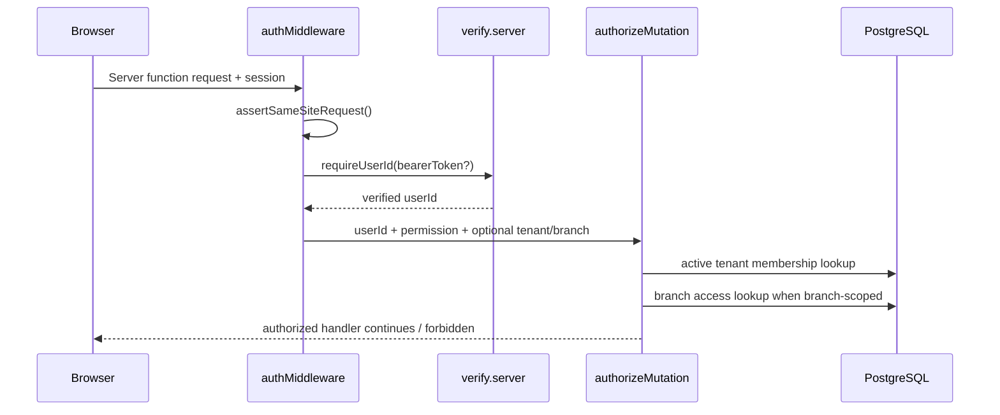

# Authentication and Authorization Model

**Status:** Source-traced baseline — 2026-11-02  
**Baseline SHA:** `e5d7c89a73718f35e7accbae7933af36c366bbc1`

## Authentication
- Better Auth is configured server-side in `src/lib/auth/server.ts`.
- Catch-all API route: `src/routes/api/auth/$.ts` delegates GET and POST requests to `auth.handler(request)`.
- The app uses TanStack Start cookies integration.
- `authMiddleware` has a client hook that forwards a bearer token for partitioned live-preview contexts, and a server hook that applies same-site request isolation then resolves a verified user ID.
- `verify.server.ts` fails closed when a real database is configured but authentication is disabled, except for the explicitly gated CI test database case.
- Production auth configuration requires `BETTER_AUTH_SECRET`; production provider configuration is environment-dependent. Source includes Google OAuth configuration; preview broker behavior is separate.

## Authorization chain

## Roles and permissions
| Role | Menu read/write | Settings read/write | Team read/write | Orders read/write | Analytics read |
|---|---|---|---|---|---|
| owner | Yes | Yes | Yes | Yes | Yes |
| admin | Yes | Yes | No | Yes | Yes |
| editor | Yes / Yes | No | No | No | No |
| staff | Yes / No | No | No | No | No |

Source of truth: `src/lib/auth/permissions.ts`. This table summarizes the explicit role permission map; individual handlers may enforce additional business rules.

## Branch access
- Membership lookup is keyed by verified `userId` and optionally a requested tenant ID.
- Membership must be active.
- Owner/admin bypass explicit branch assignment checks inside `canAccessBranch`; other roles require `branchScope` inclusion or a `member_branch_access` row.
- `authorizeMutation` combines membership, role permission, and optional branch access.
- `requirePlatformAdmin` checks durable `menu_v3.is_platform_admin(userId)`, then the configured fallback identity/email allowlist.

## Security controls evidenced
- Same-site/sibling-origin scripted request guard in `isolation.server.ts`.
- Session verification server-side.
- Zod validators on critical server function inputs.
- Tenant/branch predicates in data queries and resource checks.
- Server-only AI credential descriptors/router.
- Platform admin authorization is separate from tenant membership.

## Important caveats
- A client-supplied tenant ID is a selector, not authority: server-side membership must prove access.
- Do not assume every route uses the same middleware; inspect each exported server function.
- The exact runtime DB login role remains UNKNOWN.
- This document is not a penetration test and does not prove all server functions are correctly guarded.

## F6.1 findings and caveats

- `docs/security/F6_AUTH_SESSION_AUTHORIZATION_ASSURANCE.md` is the current detailed assurance record.
- Membership lookups in `src/lib/menu/orders.ts`, `options.ts`, `option-groups.ts` and `product-metadata.ts` do not consistently require `tenant_members.is_active = true`. The current team-removal path deletes membership rows; no in-product soft-deactivation write was found, so reachability of inactive rows is UNKNOWN. Do not treat these paths as verified safe.
- `updateOrderStatus` applies `authorizeMutation(..., "orders.write")` only to the initial `new → confirmed` transition. Require consistent authorization on all transitions in a separate test-first remediation.
- Better Auth cookie cache is configured for 300 seconds; revocation freshness is not runtime-verified.
- `advanced.useSecureCookies: false` coexists with explicit `secure: true` defaults and `__Host-` cookie names; actual response headers remain UNKNOWN.
- The effective PostgreSQL connection principal and its RLS/BYPASSRLS behavior remain UNKNOWN.
- F5.3 `saveBranch` branch-hours side-effect path remains DEFERRED BY OWNER — OPEN RISK.

## Tests
Relevant tests include:
- `src/lib/auth/authorization.server.test.ts`
- `src/lib/auth/permissions.test.ts`
- `src/lib/auth/platform-admin.server.test.ts`
- `src/lib/auth/gate-identity.test.ts`
- `tests/auth-email-flow.test.mjs`
- `tests/team-invitations.test.mjs`
