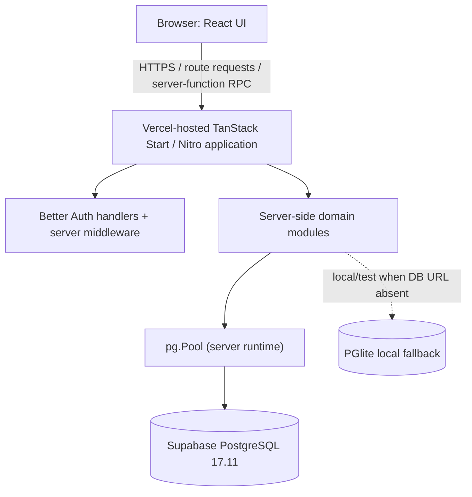

# C4 Container and Runtime Topology — Menuun

**Status:** F2 implementation baseline — 2026-11-02  
**Main baseline SHA:** `e5d7c89a73718f35e7accbae7933af36c366bbc1`  
**F2 branch:** `feat/f2-production-safe-migrations`

## Verified containers
| Container | Technology / responsibility | Evidence |
|---|---|---|
| Browser application | React 19, TypeScript, TanStack Router; public menu and authenticated workspaces | `package.json`, `src/routes/**` |
| TanStack Start server application | Server routes and server functions; server-side auth/domain/data access | `@tanstack/react-start`, `src/lib/**` |
| PostgreSQL database | Supabase PostgreSQL 17.11; application schema `menu_v3` plus legacy `public` schema | Read-only Supabase catalog query, 2026-11-02 |
| Local/test persistence | PGlite fallback when no supported PostgreSQL connection URL is configured | `src/lib/db.ts` |
| Migration runner | Node.js script using `pg.Pool`; applies repository SQL files against `menu_v3` | `scripts/migrate.mjs` |
| Hosting | Vercel; configured region `icn1` | `vercel.json` |

## Runtime topology


**VERIFIED:** The application database adapter selects PostgreSQL when one of `DATABASE_URL`, `POSTGRES_URL`, `POSTGRES_PRISMA_URL`, `SUPABASE_DB_URL`, or `POSTGRES_URL_NON_POOLING` is present; otherwise it selects PGlite. PostgreSQL pool uses `search_path=menu_v3,public`, max 2 connections per app instance, and keepalive.

**UNKNOWN:** Actual Vercel function packaging, instance scaling, cold-start behavior, and whether all Production requests use the same runtime configuration were not independently observed in this F1 pass. Do not infer a separate worker, queue, microservice, Redis cache, or object-storage container.

## Build and migration coupling — high-priority operational risk
Current `package.json`:
```json
"build": "node scripts/with-app-env.mjs vite build && node scripts/ensure-pglite-asset.mjs && npm run db:migrate",
"db:migrate": "node scripts/migrate.mjs"
```

**VERIFIED:** A build can open a PostgreSQL connection and apply pending migrations if a supported database URL is present. The runner uses a single `pg.Pool` connection, creates/uses `menu_v3._migrations`, and applies each pending file in a transaction.

**VERIFIED:** Repository F0 history records Preview builds invoking the runner; the observed builds logged `[migrate] up to date.` The earlier project incident record documents a Preview migration side effect against the connected Supabase project.

**PROPOSED for F2:** Make build artifact creation side-effect free. Migration execution must become a deliberate, separately authorized release operation with environment-target safeguards and auditable evidence. F1 does not change this behavior.

## Database evidence snapshot
- Project ref: `ublxptcqefujkbeepylc` (project identity, not a credential).
- Region: `ap-northeast-2`.
- PostgreSQL: `17.11`.
- `menu_v3`: 47 base tables; `public`: 16 base tables.
- Custom migration ledger: 72 entries; latest `20261023120000_restaurant_tables_and_qr_tokens.sql`.
- Supabase CLI migration history is a separate historical mechanism and is not the custom runner's ledger.

## Evidence
`package.json`, `vite.config.ts`, `vercel.json`, `src/lib/db.ts`, `scripts/migrate.mjs`, `scripts/migration-plan.mjs`, `docs/decisions/ADR-0001-custom-migration-ledger.md`, `docs/operations/PRODUCTION_SAFE_OPERATIONS.md`.
