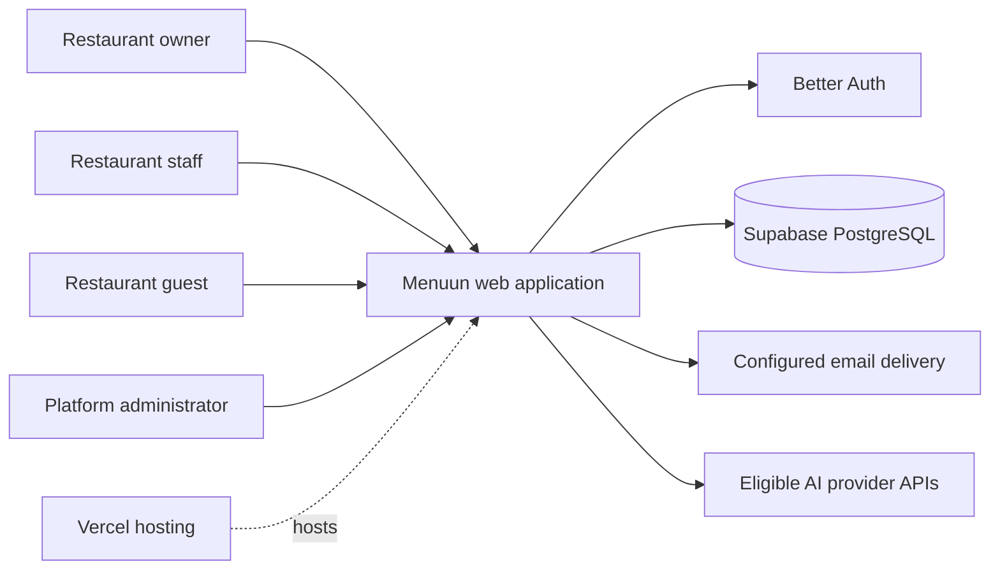

# C4 System Context — Menuun

**Status:** F1 baseline — 2026-11-02  
**Repository baseline:** `e5d7c89a73718f35e7accbae7933af36c366bbc1`  
**Evidence labels:** VERIFIED / INFERRED / UNKNOWN / PROPOSED

## Scope
**VERIFIED:** Menuun is an Arabic-first, bilingual, mobile-first, multi-tenant restaurant digital-menu SaaS. This document describes the product boundary and directly evidenced actors/dependencies, not a complete network inventory.

## People and systems
| Element | Relationship | Evidence |
|---|---|---|
| Restaurant owner | Creates and manages a restaurant workspace, menu, branches, staff, orders and subscription settings | `src/routes/studio.tsx`, `src/lib/menu/owner.ts`, `src/lib/menu/platform.ts` |
| Restaurant staff | Uses authorized workspace functions according to membership role and branch scope | `src/lib/auth/permissions.ts`, `src/lib/auth/authorization.server.ts` |
| Guest/customer | Reads published public menu; may submit an order or use a table QR token | `src/routes/m.$slug.tsx`, `src/lib/menu/order-public.ts`, `src/lib/menu/table-qr-public.ts` |
| Platform administrator | Uses privileged platform operations after server-side admin verification | `src/lib/menu/platform.ts`, `src/lib/auth/platform-admin.server.ts` |
| Menuun web system | The system in scope | Repository source |
| Supabase PostgreSQL | Persistent relational database used through server-side `pg` pool when a supported DB URL is configured | `src/lib/db.ts`, `scripts/migrate.mjs` |
| Vercel | Hosting/deployment platform; `vercel.json` declares region `icn1` | `vercel.json`, release policy |
| Better Auth | Authentication/session framework running server-side | `src/lib/auth/server.ts`, `src/routes/api/auth/$.ts` |
| Email provider(s) | Email delivery is implemented behind application email helper; exact active provider depends on runtime configuration | `src/lib/auth/email.ts`; provider configuration remains environment-dependent |
| AI providers | Server-side AI execution candidates are selected through provider registry/router; only runtime-eligible providers are active | `src/lib/menu/ai-capability-router.ts`, `ai-provider-registry.ts` |

## Context diagram

**Diagram qualification:** External email and AI provider families are present in source, but the exact providers successfully configured in Production are **UNKNOWN**. The diagram does not assert direct browser-to-database access.

## Trust boundaries
1. Public browser ↔ public routes/server functions.
2. Authenticated browser ↔ Better Auth session ↔ authenticated server functions.
3. Server runtime ↔ PostgreSQL credentials and tenant data.
4. Server runtime ↔ external email/AI provider credentials.
5. Platform-admin operations require a separate server-side authorization check.

## Explicit unknowns
- Exact Production environment-variable values and external provider activation.
- Full external-service inventory including domain/DNS, analytics, monitoring and storage.
- Whether any separately operated staging database is used.
- Exact deployed PostgreSQL login role used by the application.
- Current production deployment SHA at the time this document is read.

## Evidence
- `AGENTS.md`
- `src/routes/m.$slug.tsx`, `src/routes/m.$slug.$branch.tsx`
- `src/routes/api/auth/$.ts`
- `src/lib/auth/server.ts`, `src/lib/auth/middleware.ts`
- `src/lib/db.ts`, `scripts/migrate.mjs`
- `src/lib/menu/ai-capability-router.ts`
- C4 model guidance: https://c4model.com/diagrams/system-context
