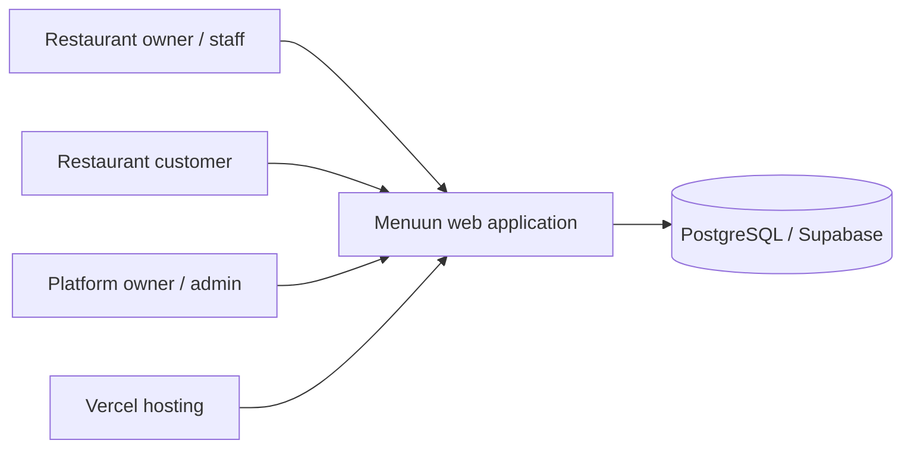

# F2 Current Evidence Addendum — 2026-11-02

This addendum supersedes earlier F0/F1 statements where newer source, Git, or live catalog evidence is available. The original baseline is retained below as historical context.

**F2 status — VERIFIED COMPLETE:** PR #415 merged the build/migration boundary at main SHA `848d4acdd3b184c24142d1e77fc0c9af55f20eab`. Exact feature-head Quality/W9 succeeded and Vercel Production is READY on that SHA. This addendum supersedes earlier statements below that F2 was unmerged or CI/deployment were pending.

**VERIFIED:** F1 source inspection and live Supabase catalog inspection are recorded in the linked architecture documents. See [DATABASE](./DATABASE.md), [AUTH](./AUTH_AND_AUTHORIZATION.md), [TENANT ISOLATION](./TENANT_AND_BRANCH_ISOLATION.md), and [DEPLOYMENT](./DEPLOYMENT.md).

**VERIFIED:** Live catalog snapshot: 47 `menu_v3` tables, 16 `public` tables; all 47 `menu_v3` tables have RLS enabled; seven restrictive deny policies were observed; zero FORCE RLS tables; zero direct table grants for API roles and no schema USAGE for those roles; 72 entries in `menu_v3._migrations`.

**CORRECTION:** Any earlier F0 summary claiming zero policies in `menu_v3` is superseded: seven policies were observed on the seven tables listed in `DATABASE.md`. The 40-table no-policy count remains correct for the snapshot.

**UNKNOWN:** Effective login role of the application's deployed PostgreSQL pool, current Production deployment SHA, exact Preview/Production database target mapping, and exhaustive server-function authorization coverage.

---

# Menuun System Overview — Verified Baseline

**Program:** F-Series / F1 input  
**Baseline date:** 2026-11-02  
**Repository:** `Midosd249/Menu_V3`  
**Original F0 baseline main SHA:** `5a84d31282383e191472bcd3fc7d5b62417e90ca`  
**F1 evidence snapshot SHA:** `e5d7c89a73718f35e7accbae7933af36c366bbc1`  
**Confidence:** Partial baseline. This is not yet a complete C4 architecture audit.

## 1. Product boundary

**VERIFIED:** Menuun is an Arabic-first, bilingual, mobile-first, multi-tenant digital-menu SaaS for restaurants and cafes. The repository's `AGENTS.md` describes the product and requires preserving existing capabilities rather than rebuilding them.

**VERIFIED:** The repository has public restaurant-menu routes and separate authenticated workspaces. Existing project documentation identifies Studio, Owner, Admin, onboarding, and public menu responsibilities. The exact current route-to-component map remains an F1 source-inspection task.

**INFERRED:** The product's primary value chain is restaurant setup and menu publishing → customer menu discovery → configured customer action/order → restaurant-side operational handling. Each transition must be confirmed against current routes and server functions before this is treated as a complete journey map.

## 2. Verified technology and platform facts

| Area | Baseline fact | Evidence/status |
|---|---|---|
| Frontend | React 19 + TypeScript | VERIFIED — repository `AGENTS.md` and `package.json` |
| Application framework/routing | TanStack Start/Router | VERIFIED — `AGENTS.md`, package dependencies |
| Build tooling | Vite | VERIFIED — `package.json` build script |
| Styling | Tailwind CSS | VERIFIED — `AGENTS.md`, dependencies |
| Authentication | Better Auth | VERIFIED — `AGENTS.md`, dependency |
| Database | PostgreSQL; PGlite-ready data layer; Supabase production integration | VERIFIED as repository-declared stack; exact runtime access paths require F1 tracing |
| Hosting | Vercel | VERIFIED — repository deployment policy and `vercel.json` |
| CI runtime | Node 24 is declared in repository guidance | VERIFIED — `AGENTS.md`; inspect workflow before relying on exact job matrix |
| Migration runner | Custom Node runner at `scripts/migrate.mjs` | VERIFIED — source inspected |
| Migration folder | `migrations/` | VERIFIED — source runner |
| Migration ledger | `menu_v3._migrations` | VERIFIED — source runner |
| Build/migration boundary | Build is artifact-only; migrations are explicit operator actions | VERIFIED — PR #415; earlier F1 statement below is historical |

## 3. Known repository structure

The following map is a starting index, not a complete ownership map:

- `src/` — application source, routes, UI, and domain logic.
- `src/routes/` — TanStack Start routes, including onboarding and workspace/public surfaces.
- `src/lib/auth/` — authentication, authorization, permissions, and identity helpers.
- `src/lib/menu/` — menu, team, invitations, subscriptions, and domain logic.
- `migrations/` — PostgreSQL migration files.
- `.github/workflows/` — CI workflow definitions; inspect current files before changing them.
- `scripts/migrate.mjs` — custom migration runner.
- `package.json` — build and verification command definitions.
- `AGENTS.md`, `PROJECT_STATE.md`, `PLAN.md`, `TASKS.md`, `SESSION_PROTOCOL.md` — repository operating and continuity contract.
- `docs/release-only-vercel-workflow.md` — established release-only Vercel workflow.

## 4. High-level system context (partial)

**Diagram limitation:** This is a conceptual boundary diagram. It does not claim a verified network topology, direct database connectivity model, exact deployment regions, edge/runtime placement, or complete set of external services. Those details are F1 work.

## 5. Critical trust and data boundaries

**VERIFIED repository policy:**
- Authentication and authorization must be server-side.
- Client-supplied identity, tenant, role, or privilege must not be trusted.
- Tenant and branch isolation must be preserved.
- Secrets and credentials must not be committed.
- The public menu and authenticated workspaces must retain their existing authorization/data boundaries.

**VERIFIED migration boundary:**
- The custom migration runner selects a configured PostgreSQL connection string from supported environment variables.
- It creates/uses schema `menu_v3`, creates `menu_v3._migrations`, checks applied migration names, and executes pending SQL files transactionally one file at a time.
- **HISTORICAL F1 baseline, superseded by F2:** the application `build` script invoked this runner via `npm run db:migrate`. PR #415 removed that build-time migration coupling.
- Repository continuity records a Preview build applying migration `20261023120000_restaurant_tables_and_qr_tokens.sql` to the connected Supabase project. This is evidence that Preview build and database mutation were coupled in at least one real run.

**HISTORICAL risk, remediated by F2:** a Preview or ordinary build with production database credentials could mutate production schema. PR #415 removed the implicit build-time migration execution path; explicit migration safeguards are documented in the migration runbook.

## 6. Migration-ledger distinction

Two mechanisms must not be conflated:

1. **Repository custom runner:** reads files from `migrations/` and tracks them in `menu_v3._migrations`.
2. **Supabase CLI migration history:** official Supabase CLI documentation describes `supabase_migrations.schema_migrations` for files managed through the Supabase CLI workflow.

**VERIFIED:** The custom runner source uses `menu_v3._migrations`. Existing continuity notes explicitly state that this custom runner/ledger is the operational canonical chain under the current repository decision, while Supabase CLI history is audit evidence only.

**RULE:** Do not run `supabase db push`, `supabase migration repair`, or another migration mechanism against the connected production project merely to make histories appear aligned. First inspect the repository decision, actual schema state, both ledgers, and obtain explicit authorization for any change.

See [ADR-0001](../decisions/ADR-0001-custom-migration-ledger.md).

## 7. Deployment boundary

**VERIFIED:** `docs/release-only-vercel-workflow.md` requires local development/QA, applicable CI quality gates, final diff review, one coherent release batch, merge to `main`, one intentional production deployment, real-device/production QA, and a recorded result.

**VERIFIED policy:** Preview deployments are exceptions for behavior that cannot be established locally. Ordinary CSS/theme iteration must not require Vercel deployments. CI success and Preview READY are not production deployment evidence.

**UNKNOWN:** Current live production deployment SHA/state was not re-queried as part of this documentation task. Do not use this baseline SHA as a claim about what Production currently serves.

## 8. F1 residual evidence limitations (not blockers to F1 completion)

The following are intentionally not asserted as complete:

- Exact system context and verified external actor/system inventory.
- Complete route, server-function, and component map.
- Current schema inventory and entity relationship diagram.
- Current auth/session/permission sequence diagrams.
- Full tenant/branch resolution and adversarial access matrix.
- Complete API/server-function contracts.
- Data-flow diagrams for signup, onboarding, publish, menu read, order submission, QR table order, subscription changes, team invitations, and platform administration.
- Current Vercel deployment/runtime topology and environment mapping.
- External integration inventory and failure semantics.
- Storage/asset ownership and backup coverage.
- Current production database identity per deployment environment.

## 9. Sources inspected for this baseline

- `AGENTS.md`
- `README.md`
- `package.json`
- `scripts/migrate.mjs`
- `vercel.json`
- `docs/release-only-vercel-workflow.md`
- `PROJECT_STATE.md`, `PLAN.md`, `TASKS.md`, and `SESSION_PROTOCOL.md`
- GitHub main history through `5a84d31282383e191472bcd3fc7d5b62417e90ca`
- PR #411 merged record and final-head Quality/W9 evidence

F1 artifacts are complete and merged. Residual details above remain UNKNOWN where evidence is incomplete; they do not reopen F1.